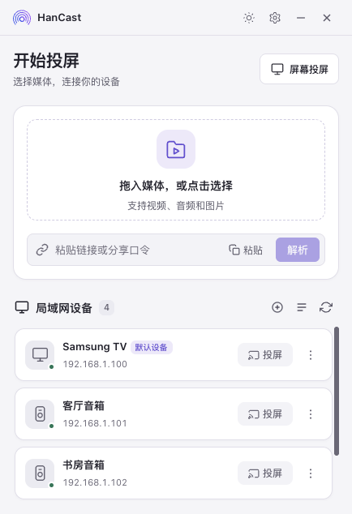
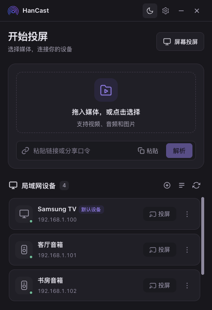

<!-- 最后校对：2026-11-06，对应版本 v2.4.12（package.json:4；本版改动：发布链路 publish 化 + 应用内更新 + 手机镜像接收 + 队列图片项续播）。数字与 文件:行号 引用由 tools/check-doc-freshness.py 机械核对 -->

<p align="center">
  <a href="README.md"></a>
  <a href="README_en.md"></a>
</p>

<p align="center">
  
</p>

<h1 align="center">HanCast</h1>

<p align="center">
  <strong>跨平台无线投屏与接收端应用</strong>
</p>

<p align="center">
  开源跨平台投屏工具 — 拖拽文件到电视，手机投屏到电脑，一步到位。
</p>

<p align="center">
  
  
  
  
</p>

<p align="center">
  <a href="https://apps.microsoft.com/detail/9nk1xwpg6hd5?launch=true&mode=mini">
    
  </a>
</p>

<p align="center">
  
</p>

<p align="center">
  
  
  
</p>

<p align="center"><sub>左/中：v2.3.20 起的「克制精致的原生工具」界面（亮 / 暗）；右：Windows 实机。</sub></p>

---

## 功能特性

### 发送投屏

拖拽文件或粘贴链接，选择设备，一键投屏。

| 媒体源 | 操作 | 示例 |
|--------|------|------|
| **本地文件** | 拖拽视频 / 音频 / 图片到窗口 | `.mp4` `.mp3` `.jpg` |
| **网络链接** | 粘贴 HTTP / HTTPS 直链 | `https://example.com/video.mp4` |
| **平台链接 / 分享口令** | 直接粘贴，规则包自动解析取流 | `bilibili.com/video/BV...`、抖音分享口令、`b23.tv` 短链 |
| **整个文件夹** | 「📁 选文件夹」→ 队列面板排序/勾选后投给设备 | 剧集目录连播；图片项按停留档位（5/8/15/30 秒）自动续下一项 |
| **剪贴板** | 复制链接后直接粘贴 | — |

平台链接的解析能力来自**可插拔的规则包**（见下面「解析规则包」），程序本体不带任何站点规则；
B 站投屏还能在播放中**切换画质**，切完自动续上进度。

### 屏幕投屏

把本机屏幕或**指定窗口**推上大屏，同时给浏览器一个免安装观看页（HLS，两条通道独立）。

- Windows 可采**系统声音**（WASAPI 环回）与麦克风，macOS 走 CoreAudio Audio Tap
- Linux 的 Wayland 会话（Hyprland / sway）由随包原生 helper `hancast-wlgrab` 抓屏
  ——ffmpeg 在 Wayland 下只能抓到空的 root window，**投得起来、帧率正常、每帧纯黑**，
  所以 v2.3.19 起宁可失败并报原因，也不退回 x11grab
- 观看页链接一键复制，手机扫码即看
- 投屏中实时显示观众数、分片状态与失败原因

### 手机屏镜像接收（Android → 本机）

方向反过来：把**安卓手机的画面接到这台电脑**，窗口可缩放、可录制，剪贴板与电脑互通。

- 走成熟的 `scrcpy` 子进程 + 独立窗口（零拷贝），HanCast 只管工具链定位与会话生命周期
- `adb` / `scrcpy` **不随包、不自动下载**：检测不到就在面板里按当前系统给出安装命令（Homebrew / winget / pacman），也支持手动指定路径
- 有线设备直接用；无线走「首次有线拿序列号 → adb pair → adb connect ip:port」
- 运行状态变化（手机拔线、scrcpy 退出、外部终止）实时回报并在界面显示原因，不靠轮询猜
- 首页第三颗常驻按钮进入面板；画质 / 帧率 / 窗口选项 / 剪贴板共享的偏好会记住，**设备选择只在本次运行有效**（重启后 adb 端口会变）

详见 [docs/手机镜像.md](docs/手机镜像.md)。

### 投屏失败看得见

窗口收进托盘时，界面里那条红字没人看得见——表现就是「点了没反应，不知道为什么」。
所以五条失败出口都会**发系统通知**并把**隐藏的窗口带回前台**，正文是设备返回的原文：

| 场景 | 通知内容 |
|------|----------|
| 投屏被设备拒绝 | `投屏失败` + `设备名：电视返回的原因`（如 `HTTP 500 …请在电视上打开「多屏互动/无线投屏/DLNA」`） |
| 停止指令没送达 | `已停止，但电视可能还在播` + 未确认的设备与原因 |
| 屏幕投屏会话中途报错 | 采集进程退出的原文（同一句话只弹一次） |

macOS 由壳层直发 `UNUserNotificationCenter`（系统通知权限在每次重新打包后需重新授予），
Linux 走 DBus 桌面通知，Windows 走 Toast；拿不到权限时静默降级，界面里的红条始终在。

### 应用内更新

发现新版之后不用离开应用去网页挑安装包（v2.4.12 起）：

- 「发现新版本」里直接**挑产物**（Linux 上 AppImage / deb / rpm / Arch 四选一，默认按本机装法给推荐项）
- **应用内下载**：实时进度与速度、可取消、断了从断点续传（`.part` + HTTP Range）
- 下完**按 GitHub 声明的 sha256 校验**再装；GitHub 没声明摘要时界面上如实说「未做摘要校验」
- 能自动装的（Windows NSIS / macOS dmg / Linux AppImage）就**退出并装上**；需要 root 的（deb / rpm / Arch）给一条可复制的安装命令
- **国内镜像开关就在更新弹窗里**：打开后请求先走镜像前缀、失败自动回退直连，两条路的失败原因都进程序日志
- 弹窗里不会再出现原作者仓库（gitee）那类第三方下载地址

### 解析规则包

站点解析走 QuickJS 沙箱里的 JS 规则包，或一段 JSON 的声明式规则：

- 设置页可导入 ZIP / URL，或**从官方索引一键检查更新**（sha256 校验）；国内直连 GitHub 不通时可打开「GitHub 走国内镜像」，索引、包下载、检查更新、FFmpeg 下载与**应用内更新的安装包**都先走镜像，失败自动回退直连（同一个 `github.mirror_enabled` / `github.mirror_prefix` 后台参数，更新弹窗里也能直接开关）
- 装了 `hosts: ["*"]` 的**通用兜底规则**后，粘到没有专属规则包的站点也会先试通用规则，通用也解不出来才报错并记进台账
- 沙箱提供 `host.fetch` / DOM 选择 / Cookie / 签名原语（md5・sha・HMAC・AES・RSA），脚本碰不到 Python
- 粘了但解析不出来的地址按域名记进**失败台账**，设置页可查可清——它就是下一批规则包的待办清单

### 接收投屏


电脑化身 DLNA 接收端。手机上爱奇艺、B站等 App 的投屏按钮，点一下就能在电脑大屏上播放。

- 底层搭载 MPV 播放器，几乎支持所有媒体格式
- 接收到投屏请求时自动启动播放，能够记住上次窗口位置跟大小

### 投屏控制


投屏启动后，点击设备卡片打开控制面板：

- 实时预览媒体封面与标题
- 音量调节+进度调节
- 一键停止投屏
#### 多设备投屏控制


- 可以同时给不同设备投屏，并且保持控制器状态  

### 投屏安全


- **投屏确认** — 未知设备投屏时弹窗确认，防止误投
- **超时自动拒绝** — 15 秒内未操作则自动拒绝（时长可配置）
- **信任管理** — 支持「允许一次」或「始终允许」，信任设备下次不再询问

### 后台参数与日志面板


- 32 项后台参数（发现心跳、解析预算、索引超时、UA、分片时长、GitHub 镜像等）在设置页集中可调，改完即时生效、只落本机配置
- 应用内日志面板直接看 sidecar 日志与级别切换，导出按钮一键打包诊断信息——出问题不用先猜日志在哪

## 下载应用

| 渠道 | 链接 |
|------|------|
| GitHub Releases（**当前版本在这里**） | https://github.com/pingod/HanCast/releases/latest |
| Microsoft Store | https://apps.microsoft.com/detail/9nk1xwpg6hd5 |

> **为什么这里不再有 Gitee 那一行**（v2.4.12 起删掉）：那条链接指向的是**原作者**仓库
> （`gitee.com/buxiangqumingzi/han-cast`），它的 releases 停在 **v2.1.0**、正文是原作者的
> changelog——点进去只会拿到三年前的旧版，跟我们的发布线没有关系。
> **不是「我们没有国内加速」**：国内直连 GitHub 取不到产物时，走的是**应用内的 GitHub 镜像开关**
> （更新弹窗里就能打开，见下面「应用内更新」），下载、校验、安装全程在应用里完成，不用再去网页挑。

> **推 tag 即 publish，产物不齐就不发**（v2.4.12 起）：CI 三平台构建成功后，release job 先数齐
> 六件安装包（macOS `.dmg` / Windows `-setup.exe` / Linux deb、rpm、AppImage / Arch `.pkg.tar.zst`），
> **缺任一就整条不发**；齐了就直接 publish 成正式 Release，上面那条 `releases/latest` 链接当场指向这一版。
> 写这行时最新公开版是 **v2.4.11**（10 项产物：上面六件 + 4 个官方规则包 zip）。
> draft 只留给**手动触发的构建**（`workflow_dispatch` 勾 `make_release`）——那是「先看看这份包」，不是发布通道。
> 旧规矩（每个 tag 先出 draft、人工验收后才点 publish）在 v2.4.11 及以前生效，代价是攒下 22 个
> 从未公开的 draft，而 `releases/latest` 看不见 draft、更新检查就一直报旧版本；细节见
> [docs/构建与发布.md](docs/构建与发布.md) §4.5 与 §5.1。
> 代码与产物都在这一条发布线上：[pingod/HanCast](https://github.com/pingod/HanCast)；
> 上游 [lanzeweie/HanCast](https://github.com/lanzeweie/HanCast) 的 `main` 停在 v2.1.0
> （v2.1.0 → 现行的合并请求还挂着），要最新代码请克隆 fork。

Windows（x64 NSIS 安装包）、macOS（arm64 `.app` / `.dmg`）、Linux（deb / rpm / AppImage）
与 Arch（`hancast-<版本>-1-x86_64.pkg.tar.zst`，装法 `sudo pacman -U <包文件>`）产物
均由 CI 随每个 tag 发布，详见 [docs/构建与发布.md](docs/构建与发布.md)。
---

## 开发者快速开始

### 前置依赖

| 依赖 | 版本 | 说明 |
|------|------|------|
| [Node.js](https://nodejs.org/) | >= 18 | 前端构建 |
| [Rust](https://rustup.rs/) | 最新 stable | Tauri 构建 |
| [Python](https://python.org/) | >= 3.11 | 后端运行 |
| [uv](https://docs.astral.sh/uv/) | 最新 | Python 包管理（推荐） |
| [MPV](https://mpv.io/) | 任意 | 接收投屏需要，发送投屏可选 |
| [FFmpeg](https://ffmpeg.org/) | 需带 x264 + HLS | 屏幕投屏需要；**程序不捆绑**，运行时自动检测本机已装的版本 |

打包时 mpv 取自 `src-tauri/mpv/`（`bundle.resources` 的 `mpv/*` 指向这里）；放好后跑
`node scripts/check-resources.cjs` 自检每条 glob 是否命中。

**FFmpeg 不随包**（v2.3.11 起）：Sidecar 按「设置里手动指定的路径 → 本机 PATH 与各平台常见安装目录 →
本程序下载到 `<配置目录>/bin/` 的那份」的顺序找可执行文件。找不到时，屏幕投屏面板会弹出
「需要下载运行依赖」，给出本平台包管理器命令、一个「下载并继续」的按需下载入口，
以及打开依赖目录的按钮。详见 [docs/屏幕投屏.md](docs/屏幕投屏.md)。

### 安装与运行

```bash
# 克隆仓库
git clone https://github.com/pingod/HanCast.git
cd HanCast

# 安装依赖
npm install
cd hancast-backend && uv sync && cd ..

# 启动开发模式（前端 + Rust + Python 一键启动）
npm run tauri dev
```

**仅前端开发**（浏览器 mock 模式，无需 Python / Rust）：

```bash
npm run dev
# 浏览器访问 http://localhost:1420
```

**仅 Python 后端调试**：

```bash
cd hancast-backend
uv run python -m hancast_sidecar.main
```

### 生产构建

```bash
npm run tauri build
```

构建产物位于 `src-tauri/target/release/bundle/`：Windows 为 NSIS 安装包（`.exe`），
macOS 为 `.app` 与 `dmg/HanCast_<版本>_aarch64.dmg`（dmg 由 CI 单独打包，见
[docs/构建与发布.md](docs/构建与发布.md) §4），Linux 为 deb / rpm / AppImage，外加 Arch 的
`hancast-<版本>-1-x86_64.pkg.tar.zst`（Tauri 的 Linux bundler 没有 Arch 后端，由
`scripts/build-arch-pkg.cjs` 在 bundle 之后把 deb 转出来）。
Sidecar 由 `npm run build:sidecar`（Nuitka）先行产出，再由 `scripts/sync-sidecar.cjs` 并入壳层资源。

> ⚠️ 直接运行打包出来的 `HanCast` 主程序若缺少 Sidecar 会闪退——它依赖随包的 Python Sidecar。
> 开发测试请用 `npm run tauri dev`（前端 + Rust + Python 一键起）。

---

## 技术架构

```
┌─────────────────┐     invoke()     ┌─────────────────┐
│  Vue 3 前端      │ ──────────────→ │  Rust Tauri      │
│  (WebView)       │ ←────────────── │  (SidecarManager)│
└─────────────────┘   Promise/事件    └────────┬────────┘
                                              │ stdin/stdout JSON（行分隔，强制 UTF-8）
                                              ▼
                                     ┌─────────────────┐
                                     │  Python Sidecar  │
                                     │ DLNA/SSDP/解析/采集│
                                     └───────┬─────────┘
                                    IPC / 子进程 │
                              ┌────────────────┴────────────────┐
                              │  mpv（接收端播放）  ffmpeg（屏幕采集）│
                              └─────────────────────────────────┘
```

| 层级 | 技术 | 职责 |
|------|------|------|
| 前端 | Tauri 2.0 + Vue 3 + TypeScript + Pinia | UI 渲染、用户交互、状态管理 |
| 桥接 | Rust (Tauri Commands) | 进程管理、Sidecar 生命周期、IPC、剪贴板/托盘/自启 |
| 后端 | Python 3.11+ (Sidecar，Nuitka 打包) | DLNA 协议、SSDP 发现、媒体服务、屏幕投屏、解析管线 |
| 解析 | QuickJS 沙箱 + 声明式 JSON | 站点规则只来自用户安装的规则包，程序不带内置规则 |
| 播放器 | MPV (外部依赖) | 接收投屏播放、IPC 控制 |
| 采集 | FFmpeg (外部依赖) + WASAPI/Audio Tap | 屏幕/窗口采集与 HLS 切片 |

前端通过 Tauri `invoke()` 调用 Rust 命令（**95 条**，`generate_handler!` 见
src-tauri/src/lib.rs:2024-2120），Rust 通过 stdin/stdout JSON 与 Python Sidecar 通信
（Sidecar 侧注册 **86 条**，`commands.py:159-283`；回推前端的事件 **10 条**，口径与逐条清单见
[docs/HanCast-Frontend-API.md](docs/HanCast-Frontend-API.md)——`browser_request` 只到壳层，`ready` 没人订阅）。完整契约见 [docs/HanCast-Frontend-API.md](docs/HanCast-Frontend-API.md)。
数字口径以代码为准，`python3 tools/check-doc-freshness.py` 会逐项核对。

---

## 项目结构

```
HanCast/
├── src/                        # Vue 3 前端
│   ├── components/             # UI 组件（23 个，清单见 docs/HanCast-Frontend-Spec.md）
│   │   ├── TitleBar.vue        # 自定义标题栏
│   │   ├── MediaInput.vue      # 媒体输入（拖拽/链接/粘贴）
│   │   ├── DeviceList.vue      # 设备列表
│   │   ├── DeviceCard.vue      # 设备卡片（投屏/重命名/移除）
│   │   ├── CastController.vue  # 投屏控制栏（含画质切换）
│   │   ├── ScreenCastPanel.vue # 屏幕投屏面板
│   │   ├── FfmpegDepsModal.vue # 「需要下载运行依赖」弹窗（FFmpeg 不随包）
│   │   ├── UpdateModal.vue     # 应用内更新：挑产物 → 镜像开关 → 进度/校验 → 退出并安装（v2.4.12）
│   │   └── PluginSettings.vue  # 规则包管理与「检查规则包更新」
│   ├── stores/                 # Pinia 状态管理（12 个）
│   ├── locales/                # 国际化资源（zh-CN / en-US，各 492 键，必须等键：`node tools/verify-locale-keys.mjs`）
│   ├── i18n.ts                 # vue-i18n 实例 + 非组件环境取文案的 tt()
│   └── api/commands.ts         # Tauri invoke 封装
│
├── src-tauri/                  # Rust Tauri 壳层
│   ├── src/
│   │   ├── lib.rs              # Tauri 命令定义（95 条，清单见 generate_handler!，lib.rs:2024-2120）
│   │   ├── sidecar.rs          # SidecarManager（Rust ↔ Python）
│   │   └── macos_notify.rs     # macOS 系统通知（UNUserNotificationCenter，须主线程）
│   ├── mpv/                    # 外部播放器（构建前放这里；FFmpeg 不随包）
│   └── Cargo.toml
│
├── hancast-backend/            # Python 后端（Sidecar）
│   └── hancast_sidecar/
│       ├── main.py             # Sidecar 入口（stdin/stdout JSON 循环）
│       ├── commands.py         # 命令路由（86 条注册表见 commands.py:159-283）
│       ├── params.py           # 32 项后台参数登记表
│       ├── ssdp.py             # SSDP 设备发现（组播失败回退子网广播）
│       ├── protocol/
│       │   ├── dlna.py         # DLNA 控制端与描述文件
│       │   └── server.py       # UPnP HTTP 服务
│       ├── renderer/
│       │   └── mpv.py          # MPV 渲染器（IPC 控制）
│       ├── media/
│       │   ├── parser.py       # 媒体文件/URL 解析
│       │   ├── rules/          # 规则注册表（JS 包 + 声明式 JSON + QuickJS 沙箱 + 慢操作后台任务 tasks.py）
│       │   ├── share_resolver.py # 分享文本 → 可播地址（规则来自规则包）
│       │   ├── failures.py     # 解析失败台账（按域名）
│       │   └── server.py       # 本地文件 HTTP 服务 + 链路内代理
│       ├── screencast/         # 屏幕投屏：采集（含 Wayland helper wlgrab）、HLS 分片、供流、观看页
│       ├── update/             # 应用内更新：Release 清单取数（**不用** /releases/latest）、本平台产物挑选、
│       │                       # 带 sha256 校验与断点续传的下载、install_plan（v2.4.12）
│       ├── security/           # 投屏确认（Device Guard）
│       └── xml/                # UPnP 描述文件
│
├── rule-packs/                 # 官方解析规则包（4 个：bilibili / cms / douyin / template）
├── linux-capture/              # hancast-wlgrab 源码（Rust，Wayland 抓屏 helper）
├── tools/                      # 验收与探针脚本（索引见 tools/README.md）
├── scripts/                    # 版本同步、产物校验等构建脚本
├── .github/workflows/build.yml # 三平台 CI + 发布 GitHub Release（推 tag 即 publish）
├── CHANGELOG.md                # 版本历史
└── docs/                       # 文档（入口：docs/README.md）
```

---

## 开发文档

**入口是 [docs/README.md](docs/README.md)**（按问题找文档 + 阅读路径 + 维护约定）。常看几份：

| 文档 | 说明 |
|------|------|
| [docs/架构总览.md](docs/架构总览.md) | 三进程分层、端口/线程/落盘状态、架构不变量 |
| [docs/开发指南.md](docs/开发指南.md) | 环境、跑法、测试口径、调试、提交与发版规矩 |
| [docs/HanCast-Frontend-API.md](docs/HanCast-Frontend-API.md) | 95 条 invoke 命令与 10 个事件的全量契约 |
| [docs/HanCast-Frontend-Spec.md](docs/HanCast-Frontend-Spec.md) | 组件 / store / 视图、样式与 i18n 约定 |
| [docs/故障排查.md](docs/故障排查.md) | 按症状索引：发现不了、推不上去、停不下来、没声音…… |
| [docs/屏幕投屏.md](docs/屏幕投屏.md) · [docs/投屏确认.md](docs/投屏确认.md) | 两个子系统的行为契约 |
| [docs/分享解析规则.md](docs/分享解析规则.md) · [docs/解析插件开发指南.md](docs/解析插件开发指南.md) · [rule-packs/README.md](rule-packs/README.md) | 粘贴解析管线、写规则包、官方包发布 |
| [docs/构建与发布.md](docs/构建与发布.md) | 版本 SSOT、三平台打包、产物验收、发布顺序 |
| [CHANGELOG.md](CHANGELOG.md) | 每个版本改了什么 |
| [AGENTS.md](AGENTS.md) | 速览与硬约束（编码代理的入口；深度内容看上面。旧名 CLAUDE.md） |

> `docs/Macast-Frontend-*.md` 与 `docs/HanCast-Backend-Spec.md` 是历史草案，已被上面几份取代，仅作留档。
>
> 文档里的 `文件:行号` 引用可用 `python3 tools/audit-doc-refs.py` 机械校验；改代码的同一轮要改文档，约定见 [docs/README.md](docs/README.md) §4。

---

## 许可证

[GPL-3.0](LICENSE) © 2024-2026 [lanzeweie](https://github.com/lanzeweie)

基于 [xfangfang/Macast](https://github.com/xfangfang/Macast) 二次开发，继承原项目协议。

## 致谢

- [xfangfang/Macast](https://github.com/xfangfang/Macast) — 原始项目
- [Tauri](https://tauri.app/) — 跨平台桌面应用框架
- [akFace/mpv.config](https://github.com/akFace/mpv.config) — MPV 主题皮肤（modernz）
